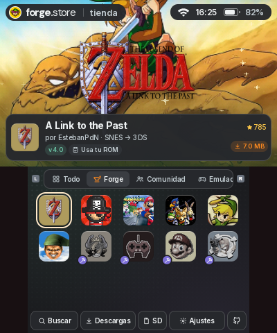

<h1 align="center">forge.store</h1>

  <strong>Every Forge port. One place on your 3DS.</strong> 
  Esteban’s Forge homebrew store, made natively for Nintendo 3DS.

  <a href="#download-and-installation">Download</a> ·
  <a href="#features">Features</a> ·
  <a href="#controls">Controls</a> ·
  <a href="#documentation">Documentation</a> ·
  <a href="CHANGELOG.md">Changelog</a> ·
  <a href="CONTRIBUTING.md">Contribute</a> ·
  <a href="#community-and-bug-reports">Community</a>

  
  
  
  

  
  
  

Native Nintendo 3DS store for my ports and for the community homebrew I use every day.
Browse banners, screenshots and trailers, read each project’s GitHub page, then download,
install and launch it without leaving the console.

This project was developed with the help of [OpenAI Codex](https://openai.com/codex/) and [Claude Code](https://claude.com/product/claude-code). Learn more about the development process [here](AI_DEVELOPMENT.md).

No ROMs, game data, DSP firmware or saves are included. Ports that need your own game
files tell you exactly which file to place on the SD card.

## Features

<table>
  <tr>
    <td width="50%" valign="top"><strong>All my ports</strong> Every Esteban’s Forge port with its banner, screenshots, trailer, requirements and release history.</td>
    <td width="50%" valign="top"><strong>Community homebrew</strong> Curated emulators and tools, plus optional Universal-DB integration and search.</td>
  </tr>
  <tr>
    <td width="50%" valign="top"><strong>Look before you install</strong> A native GitHub reader for READMEs, releases, images and repository details.</td>
    <td width="50%" valign="top"><strong>Download, install, play</strong> Download queue, verified installs, rollback, uninstall, SD browser and direct launch.</td>
  </tr>
  <tr>
    <td width="50%" valign="top"><strong>Made for two screens</strong> 400×240 above, 320×240 touch below, crisp native type, light and dark themes and eight languages.</td>
    <td width="50%" valign="top"><strong>Keep it current</strong> Built-in store updates on every launch and verified background downloads for previews.</td>
  </tr>
</table>

## Download and installation

  
  

**Stable: [v1.0](https://github.com/EstebanPdN/forge.store/releases/tag/v1.0).**

1. **CIA:** open FBI, choose **Remote Install → Scan QR Code** and scan the code on the
   right, or copy the CIA to your SD card and install it from FBI.
2. **3DSX:** copy `forge-store.3dsx` to `sdmc:/3ds/forge-store/` and open it from the
   Homebrew Launcher.
3. Launch **forge.store**, choose a theme and enter the store.
4. With Wi-Fi on, the **Store resources** package (16.04 MB of trailers) downloads in the
   background. You can browse and install while it finishes.

Keep at least 100 MB free for the store and its resources; each game needs its own space.
Compare your download with [SHA256SUMS](builds/3ds/SHA256SUMS) before installing.
The buttons and QR code always point to the newest build in this repository. Each
[GitHub release](https://github.com/EstebanPdN/forge.store/releases) keeps its own CIA, 3DSX and QR code.

**Updates are built in.** Every launch checks for a newer store build. Choose **Yes** to
download and install it, or **No** to close the store. See [Updates and cache](docs/UPDATES-AND-CACHE.md).

## Controls

| Input | Action |
| --- | --- |
| D-Pad / Touch screen | Navigate |
| A | Open / Confirm |
| B | Back |
| L / R | Change tabs |
| X | Open the GitHub page of the selected game |
| Y / START / SELECT | Scene shortcuts, always shown on the touch screen |
| Video: A · ◀ ▶ · Y · B | Pause · Seek · Mute · Return |

Drag the category strip sideways to reveal more tabs. In Captures, tap an image to view
it at full size. See the [installation guide](docs/INSTALLING.md) for everything else.

## Documentation

| Guide | Purpose |
| --- | --- |
| [Installing and using](docs/INSTALLING.md) | CIA/3DSX, first start, controls, game files and cleanup. |
| [Updates and cache](docs/UPDATES-AND-CACHE.md) | Startup updates, GitHub cache and prefetch. |
| [Building](docs/BUILDING.md) | Toolchain, build command, tests and asset generation. |
| [Architecture](docs/ARCHITECTURE.md) | Source layout, data flow and thread lifetimes. |
| [Web reference](docs/WEB.md) | The browser version of the interface used as the visual reference. |
| [Verification](docs/VERIFICATION.md) | What has been tested and what still needs hardware. |
| [All documentation](docs/README.md) | Media, HOME banner, credits and notices. |

To build it yourself, install devkitARM, libctru, Citro2D/Citro3D and the documented
portlibs, then run `zsh 3ds/build.sh`. Outputs go to `3ds/build/`.

## Community and bug reports

[Join the project Discord](https://discord.gg/BjbzfRYpV) for updates, support and
suggestions. Report reproducible problems through
[GitHub issues](https://github.com/EstebanPdN/forge.store/issues), including your
console model, CIA or 3DSX, when you installed the store and the steps to reproduce it. Never attach tokens,
ROMs, memory dumps or personal SD contents to a public report.

## Credits

- The authors of every community app in the catalog; each detail page links to its
  original repository, and its artwork is listed in the [asset register](docs/ASSET-CREDITS.md).
- [Universal-Team](https://github.com/Universal-Team) — Universal-DB.
- [devkitPro](https://github.com/devkitPro) — devkitARM, libctru, Citro2D and Citro3D.
- libwebp, NanoSVG, Theora, libjpeg-turbo, curl, mbedTLS, Jansson, libarchive and the other
  libraries in the [third-party notices](docs/legal/THIRD_PARTY_NOTICES.md).
- The Nintendo 3DS homebrew community — tools, documentation and testing.
- EstebanPdN — store design, native application and catalog, with help from Codex and Claude Code.

## License and legal notice

[Rights and licenses](LICENSE.md) are component-specific. Third-party software keeps its
original license. Game names, imagery and trademarks belong to their respective owners;
attribution is not a grant of reuse rights.

This is an unofficial homebrew project, unaffiliated with Nintendo.

---

  <a href="https://estebanpdn.github.io/">Esteban’s Forge</a> ·
  <a href="https://discord.gg/BjbzfRYpV">Discord</a> ·
  <a href="#documentation">Documentation</a> ·
  <a href="#license-and-legal-notice">License and notices</a> 
  An independent fan project. Game names and content belong to their respective owners.

