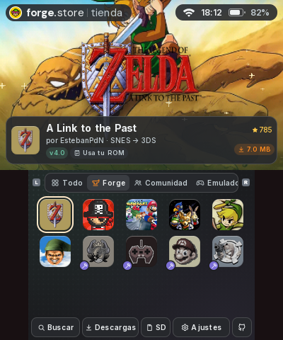

<h1 align="center">forge.store</h1>

<p align="center">
  <strong>Esteban’s Forge. On your Nintendo 3DS.</strong><br>
  A native homebrew storefront and its web design reference, made for two small screens.
</p>

<p align="center">
  <a href="#download-and-installation">Download</a> ·
  <a href="#features">Features</a> ·
  <a href="#documentation">Documentation</a> ·
  <a href="CHANGELOG.md">Changelog</a> ·
  <a href="CONTRIBUTING.md">Contribute</a> ·
  <a href="#community-and-bug-reports">Community</a>
</p>

<p align="center">
  <a href="docs/VERIFICATION.md"></a>
  <a href="docs/INSTALLING.md"></a>
  <a href="docs/MEDIA.md"></a>
  <a href="LICENSE.md"></a>
</p>

<p align="center"></p>

<p align="center">
  <a href="https://estebanpdn.github.io/"></a>
  <a href="https://discord.gg/BjbzfRYpV"></a>
  <a href="https://www.patreon.com/c/EstebanPdN"></a>
</p>

**Development build, published directly in this repository. No GitHub release has been created.**
The application targets Old and New Nintendo 3DS. Automated tests and emulator checks are
recorded in [Verification](docs/VERIFICATION.md); physical-console HOME/sleep, installation,
launch and sustained audio/video performance still need confirmation.

This project was developed with the help of [OpenAI Codex](https://openai.com/codex/) and [Claude Code](https://claude.com/product/claude-code). Learn more about the development process [here](AI_DEVELOPMENT.md).

## Download and installation

| Format | Download | Where it goes |
| --- | --- | --- |
| CIA | [forge-store.cia](https://raw.githubusercontent.com/EstebanPdN/forge.store/main/builds/3ds/forge-store.cia) | Install with FBI to the HOME Menu. |
| 3DSX | [forge-store.3dsx](https://raw.githubusercontent.com/EstebanPdN/forge.store/main/builds/3ds/forge-store.3dsx) | Copy to `/3ds/forge-store/` and open in Homebrew Launcher. |
| Integrity | [SHA256SUMS](builds/3ds/SHA256SUMS) · [build manifest](builds/3ds/manifest.json) | Verify the downloaded file before installing. |

On first entering the store, the app automatically downloads the **16.04 MB Store resources
package** in the background. Downloads shows one package with combined progress. Each video
becomes playable after its own file passes SHA-256 verification; navigation remains available.
No account or token is needed. See [Installation](docs/INSTALLING.md) for controls and cache management.

Every launch checks for a store update before the introduction. Newer builds download and
install automatically; an unavailable check continues to the store. This build enables that
updater, so older installations need one manual update first. Public GitHub pages and common
images are also cached and refreshed in the background. See [Updates and cache](docs/UPDATES-AND-CACHE.md).

Game installations are separate from this package. Some ports require files supplied by the
player; no ROMs, game data archives, DSP firmware, saves or memory dumps are included here.

## Features

<table>
  <tr>
    <td width="50%" valign="top"><strong>Built for two screens</strong><br>400 × 240 top screen, 320 × 240 touch screen, crisp type, shared tab animations, light and dark themes, and eight interface languages.</td>
    <td width="50%" valign="top"><strong>Browse the Forge</strong><br>Curated ports and community apps, search, layered banners, screenshots, trailers, requirements and release history.</td>
  </tr>
  <tr>
    <td valign="top"><strong>Install and manage</strong><br>Download queue, staged installs, integrity checks, supported rollback, SD browser, requirement detection, uninstall and application launch.</td>
    <td valign="top"><strong>Resources that stay ready</strong><br>Small native-resolution videos, verified persistent cache, automatic background downloads, explicit retry and asynchronous cache cleanup.</td>
  </tr>
  <tr>
    <td valign="top"><strong>Read without leaving</strong><br>A native GitHub reader for READMEs, releases, images and repository information. Optional Universal-DB integration.</td>
    <td valign="top"><strong>One visual reference</strong><br>The web V2 design shares catalog, art, sound and layout decisions with the C application. Original web V1 is preserved.</td>
  </tr>
</table>

The web reference uses a **simulated SD card and installer**. Native installs use the console’s
real filesystem and services. Visual parity is an ongoing measured target, not a claim that
every state or every GitHub document renders identically.

## Run the web reference

Requires Python 3. No npm install or web build is needed.

```sh
python3 tools/serve.py 8642
```

Open `http://localhost:8642`. Use **Resolución 3DS** for native resolution and the pixel
magnifier to inspect both screens. Keyboard controls follow Azahar: arrows, A/Enter, S/Esc
for B, Q/W for L/R, Z for X, X for Y, M for START and N for SELECT.
See [Web reference](docs/WEB.md). The preserved V1 is at `versions/v1/`.

## Build the application

Install devkitARM, libctru, Citro2D/Citro3D, the documented 3DS portlibs, CMake, Python 3
and zsh. The reviewed RomFS assets are included, so a normal build needs no browser,
HandBrake, proprietary game files or access to another project.

```sh
zsh 3ds/build.sh
```

Outputs go to `3ds/build/`. The default build disables RAM/VRAM dumps and has no dump-upload
endpoint. Use `FORGE_DEBUG=1` only for local testing. Read [Building](docs/BUILDING.md)
for dependencies, asset generation and test commands.

## Documentation

- [Documentation index](docs/README.md) — installation, architecture, media and maintenance.
- [Architecture](docs/ARCHITECTURE.md) — module ownership, data flow and thread lifetimes.
- [Media pipeline](docs/MEDIA.md) — HandBrake encoding, format, download contract and verification.
- [Updates and cache](docs/UPDATES-AND-CACHE.md) — startup updates, incremental GitHub requests and prefetch.
- [Verification](docs/VERIFICATION.md) — what was tested and what still needs hardware.
- [Asset credits](docs/ASSET-CREDITS.md) · [Third-party notices](docs/legal/THIRD_PARTY_NOTICES.md).
- [Contributing](CONTRIBUTING.md) · [Security](SECURITY.md) · [Changelog](CHANGELOG.md).

## Community and bug reports

Use [GitHub Issues](https://github.com/EstebanPdN/forge.store/issues) or
[join Discord](https://discord.gg/BjbzfRYpV). Include the build hash, console model,
CIA/3DSX format and steps to reproduce. Do not attach RAM/VRAM dumps, tokens, ROMs or
personal SD contents to a public report.

## License and legal notice

[Rights and licenses](LICENSE.md) are component-specific. Third-party software keeps its
original license. Game imagery and trademarks belong to their respective owners; attribution
is not a grant of reuse rights. This is an unofficial homebrew project, unaffiliated with Nintendo.
